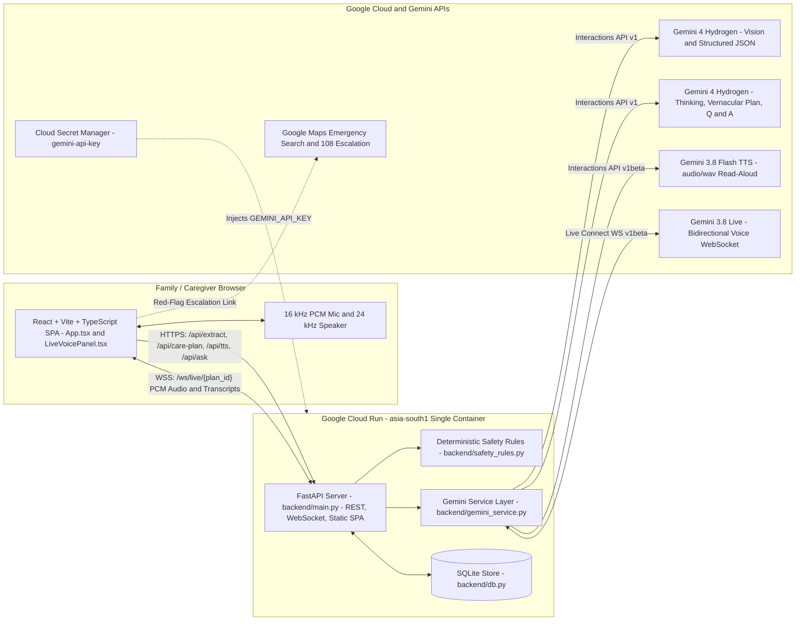
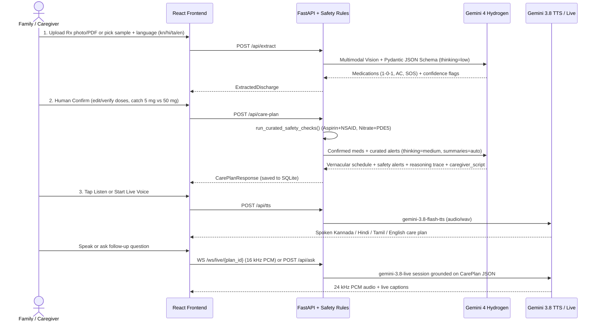

# Discharge Dost

**Safe, vernacular daily care plans from English hospital discharge summaries.**  
Built for **Gemini 4 Sprints** (Health & AI for India) on **Google Cloud Run**.

## Architecture

- **Frontend (`frontend/`)**: React + Vite + TypeScript mobile-first web app (served directly by FastAPI in production).
- **Backend (`backend/`)**: FastAPI + `google-genai` (`>= 3.5.0`) Interactions API:
  1. **Extract Agent (`gemini-4-hydrogen` Vision + Structured JSON)**: Parses photos, PDFs, or text (`1-0-1`, `AC`, `PC`, `SOS`) into strict Pydantic schemas and flags unclear/ambiguous strengths (`5 mg` vs `50 mg`) for pharmacist review.
  2. **Human-in-the-Loop Confirm Screen**: Caregivers verify or edit every extracted line before generating the care plan.
  3. **Safety Reasoner (`backend/safety_rules.py` + `gemini-4-hydrogen` Thinking)**: Deterministic drug interaction & red-flag checks (e.g., Aspirin/Ecosprin + NSAID bleeding risk, Nitrate + PDE5 hypotension, high single doses) layered with Gemini 4 thinking summaries and a live reasoning trace.
  4. **Vernacular Care Plan + Audio + Live Voice (`gemini-3.8-flash-tts` & `gemini-3.8-live`)**: Generates plain-language daily schedules (`Morning`, `Afternoon`, `Night`, `SOS`) in **Kannada**, **Hindi**, **Tamil**, and **English**, WAV read-aloud audio, real-time bidirectional Live voice Q&A over WebSocket (`/ws/live/{plan_id}`), 108 emergency + Google Maps nearest hospital escalation, and stateful care-plan Q&A.
- **Live Demo URL**: `https://discharge-dost-101451598339.asia-south1.run.app`
- **Persistence (`backend/db.py`)**: SQLite care plan + daily checklist storage (`/tmp/discharge_dost.db` on Cloud Run).

### System Architecture



### 4-Stage Clinical Flow



## Local Development

```powershell
# Backend
.\.venv\Scripts\python.exe -m uvicorn backend.main:app --reload --port 8000

# Frontend (separate terminal)
cd frontend
npm.cmd install
npm.cmd run dev
```

## Deploy to Google Cloud Run

```powershell
gcloud.cmd run deploy discharge-dost --source . --region asia-south1 --allow-unauthenticated
```
